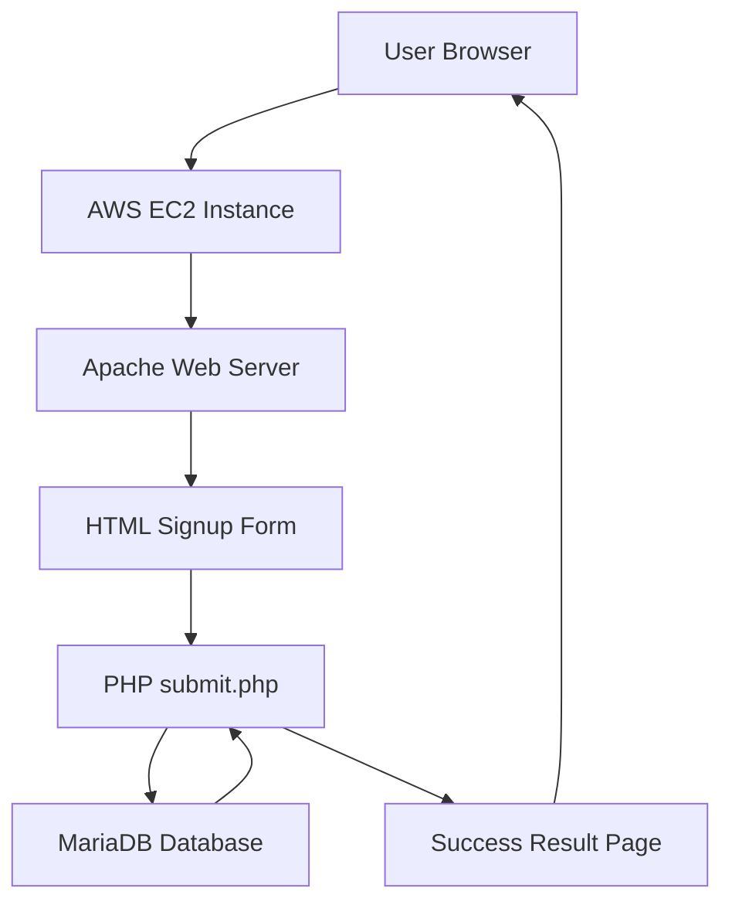

# PHP Signup Form Project on AWS

## 1. Introduction

The PHP Signup Form Project is a web-based application developed using HTML, PHP, and MariaDB. It allows users to submit their personal information through a signup form.

The application stores the submitted information in a MariaDB database and displays a success message after successful submission.

This project is deployed on an AWS EC2 instance and demonstrates the integration of a web server, PHP, and a relational database.

## 2. Objectives

- To create a signup form using HTML.
- To process form data using PHP.
- To store user information in MariaDB.
- To display submitted information on a result page.
- To deploy a web application on AWS EC2.
- To verify database records using SQL queries.

## 3. Technologies Used

- HTML
- PHP
- MariaDB
- Apache HTTP Server
- Linux
- AWS EC2
- Google Chrome

## 4. Architecture Diagram



## 5. Input Screenshot

The signup form accepts the following information:

- Name
- Email
- Website
- Comment
- Gender

The user enters the details and clicks the Submit button.


**Figure 1:** Signup form input page.

## 6. Output Screenshot

After submitting the form, the PHP script processes the information and displays a success message along with the submitted details.


**Figure 2:** Successful form submission output.

## 7. Database Verification

The submitted information is stored in the `users` table inside the `FCT` database.

The following SQL commands verify the database record:

```sql
USE FCT;

SELECT * FROM users;
```

The database contains the following columns:

- id
- name
- email
- website
- comment
- gender


**Figure 3:** MariaDB database record verification.

## 8. Application Workflow

1. The user opens the signup page.
2. The user enters personal information.
3. The form submits the data to `submit.php`.
4. PHP processes the submitted data.
5. PHP inserts the record into MariaDB.
6. The application displays a success message.
7. The record is verified using an SQL query.

## 9. AWS Deployment

The application is hosted on an AWS EC2 Linux instance.

The EC2 instance runs the Apache web server, PHP processes form submissions, and MariaDB stores user information.

The application can be accessed using the configured EC2 public IP address or domain name.

### Security Considerations

- Use HTTPS in production.
- Validate and sanitize user inputs.
- Use prepared SQL statements.
- Store database credentials securely.
- Restrict database network access.
- Configure AWS security groups appropriately.

## 10. Conclusion

The PHP Signup Form Project demonstrates how to build and deploy a dynamic web application using HTML, PHP, and MariaDB on AWS EC2.

The application successfully accepts user information, processes form submissions, stores records in the database, and displays a confirmation message.

This project provides practical knowledge of cloud computing, Linux server administration, web hosting, PHP programming, and database connectivity.

It serves as a foundation for developing more advanced web applications on AWS.

## Project Status

Successfully tested with form submission and database record verification.
